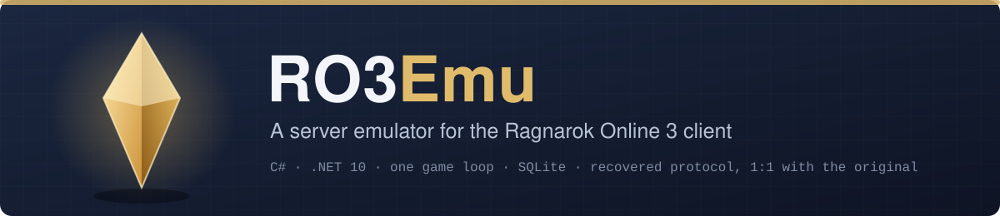
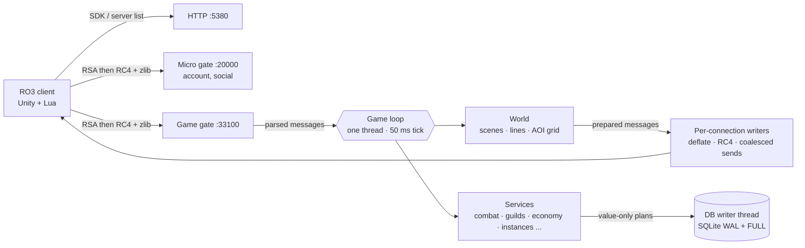

# RO3Emu: Ragnarok Online 3 server emulator

An open-source C# server emulator for the **Ragnarok Online 3 PC client**. Explore its protocol, run a local server
with data exported from your own client, or help implement and test game systems. The server uses .NET 10 and SQLite;
the client integration needs the original PC client, which this repository does not provide.

**Start here:** [Project website](https://aethai.github.io/ro3emu-server/) · [Set up a local server](#getting-started) · [See the current scope](#what-works) ·
[Browse the documentation](docs/README.md) · [Contribute](CONTRIBUTING.md) ·
[Report a bug or suggest a feature](https://github.com/aethai/ro3emu-server/issues/new/choose)

<p align="center"></p>

<p align="center">
  
  
  
  
  <a href="https://github.com/aethai/ro3emu-server/actions/workflows/ci.yml"></a>
  <a href="https://github.com/aethai/ro3emu-server/actions/workflows/tests.yml"></a>
</p>

<p align="center">
  <a href="#what-works">What works</a> ·
  <a href="#getting-started">Getting started</a> ·
  <a href="#playing-together">Playing together</a> ·
  <a href="#architecture">Architecture</a> ·
  <a href="#development">Development</a> ·
  <a href="#documentation">Documentation</a>
</p>

The PC client is a Unity (Mono) game with Lua logic. Its message table, protobuf schema, flows and config tables
provide much of this emulator's reference material. Original server behavior that the client cannot establish is
reconstructed and marked *(inferred)* in code and documentation. This is an independent project in the tradition of
Athena, eAthena, rAthena and Hercules.

---

## What works

The repository implements the areas below, with different levels of test and live-client coverage. They are an
implementation map, not a claim of complete original-server parity. See the linked system notes for inferred rules
and remaining gaps.

<table>
<tr><td valign="top" width="50%">

**World**
- SDK login, server list, both gates (RSA, then RC4 + zlib), role create / select / switch / delete
- maps, portals, NPCs, Kafra travel, map **lines** (channels) with per-map caps and line switching
- directed visibility on a grid with the client's own cap, nearest first, name boards beyond it
- monsters, spawns, MVPs, regeneration, death and revive, silent reconnect

**Combat and character**
- skills, buffs, energy, passive skills, skill growth, talents, PvP and event fights
- equipment, appraisal, affixes, enchanting, strengthening and refining, cards, emblems
- life jobs and gathering, pets (incl. tower pets), mounts, wardrobe, totems, job items (cart, falcon, Peco)
- achievements, emotes and sitting

</td><td valign="top" width="50%">

**Economy and social**
- trade center, stalls, auctions (guild, world and event), mail, NPC and point shops
- friends, parties, blacklist, chat channels, teams, adventure groups

**Guilds**
- guild management, guild home, campfire, caravan, black market, guild challenge
- **Territory Wars**: auctions, battles, escort and castle siege flows

**Instances and activities**
- dungeons, towers, matchmaking, multi-dungeons, reconstructed story dungeons and scripted story scenes
- daily activities, quests and story flows, season pages and refine, battle pass, lottery, timed events

</td></tr>
</table>

**Open content.** `Ro3Emu:OpenContent` opens supported client-visible content across server-day gates and season
windows; see its [behavior and known limits](docs/guide/open-content.md).

**Not yet:** the bar (tavern), guild voice, the chicken minigame, payments and a few niche panels. The original
server's encounter scripts are not in the client, so story dungeons and bosses are reconstructions.

## Getting started

### Quick start

1. Download **`RO3Emu-win-x64.zip`** from the [releases page](https://github.com/aethai/ro3emu-server/releases) and
   extract it anywhere (Desktop, Downloads, a games folder).
2. Double-click **`RO3Emu.exe`**. Nothing to install: no .NET, Java or Node.js, and no internet besides what the game
   itself needs. If Windows says "Windows protected your PC" (RO3Emu is not signed), click *More info*, then
   *Run anyway*.
3. The first time, it finds your Ragnarok 3 game folder (or asks you to pick the one with `ro3.exe`), exports the game
   data it needs from it (about a minute), starts the server on your PC, patches the game to talk to it and starts the
   game. Next time it only starts the server and the game.
4. Log in with any account name and password: the account is created on first login. Keep the RO3Emu window open while
   you play; press **Q** there (or close it) to stop the server.

**Don't have the game?** RO3Emu.exe downloads it from the official Genesis servers (about 24 GB) and checks every
file against the publisher's signature. It offers this when it finds no game folder, or run `RO3Emu.exe install`.
`RO3Emu.exe update` brings an installed game up to date the same way (only the changed files). RO3Emu never hosts
game files: everything comes from the publisher's own update service, verified with the publisher's own key.

| Command | What it does |
|---|---|
| `RO3Emu.exe` | play on your own server (the same as `RO3Emu.exe start`) |
| `RO3Emu.exe join <address>` | play on someone else's server (`host`, `host:port` or `http://host:port`) |
| `RO3Emu.exe host` | your server, open to friends on your network (`--public <ip>` for the Internet, `--gm <account>`) |
| `RO3Emu.exe install [folder]` / `update [folder]` | the game from the official servers, every file checked |
| `RO3Emu.exe restore` | undo the patch: the game talks to the official servers again |
| `RO3Emu.exe check` | does this game version fit this RO3Emu? (changes nothing) |
| `RO3Emu.exe diag` | `RO3Emu-diagnostics.zip` for a bug report |
| `RO3Emu.exe delete-character [address]` | delete one of your characters (the game has no delete button); log out first |

What it changes: in the game folder, a few DLLs in `ro3_Data\Managed` (originals kept in `ro3emu-backup`) and
`ro3emu\loc_en.tsv` (the English texts, built from your own game files); next to RO3Emu.exe, `data\` (game data, your
characters), `logs\` and `RO3Emu.settings.json`. When anything fails it says what to do in plain words and writes
`RO3Emu-diagnostics.zip`; attach that file to an [issue](https://github.com/aethai/ro3emu-server/issues).

> [!WARNING]
> Do not use the publisher's launcher to repair a patched game folder: it puts the original DLLs back (RO3Emu.exe
> patches again on its next start).

### Hardware

| | Minimum | Load target (500 players) |
|---|---|---|
| CPU | 2 cores | ≤ 2 cores used by the server |
| RAM | 2 GB | ≤ 2 GB working set |
| Disk | 3 GB (game data export included), plus the game | SSD recommended (SQLite WAL, `synchronous=FULL`) |

## Playing together

**On Windows**, the host runs `RO3Emu.exe host` (it prints the address friends use; Windows asks once whether the
server may use the network: allow it) and friends run `RO3Emu.exe join <that address>`. For players outside your
network, forward TCP `5380`, `20000` and `33100` to the host and start with `RO3Emu.exe host --public <public IP>`.

**On Linux**, download **`RO3Emu-server-linux-x64.tar.gz`**, extract it and run its `server.sh`; nothing to install:

```bash
./server.sh --client /path/to/ROO_PC --host <public IP> --gm <your account>      # a game folder copied from Windows
./server.sh --download /srv/ro3/ROO_PC --host <public IP> --gm <your account>    # or only the files it needs, from Genesis
./server.sh --service ...                                                        # as a systemd service
```

Open TCP `5380`, `20000` and `33100`. The database is backed up to `data/backups/` at start and every 6 hours (newest
20 kept). One account is one live session: a second login kicks the older connection. The client allows one instance
per machine; `Ro3Emu.BotCli` stands in for more players when testing alone.

GM commands (`!help` in chat) are enabled per account with `--gm` (`Ro3Emu:GmAccounts`); on your own PC
(`RO3Emu.exe start`) every account has them, a hosted server started as Production gives them to nobody else
([`docs/guide/gm-access.md`](docs/guide/gm-access.md)). Players report bugs with the menu's Feedback button or `/bug <text>` in
chat ([`docs/guide/feedback.md`](docs/guide/feedback.md)).

## Running from source

Developers need only the [.NET 10 SDK](https://dotnet.microsoft.com/download/dotnet/10.0). `start.cmd` builds the
server, the client DLLs and RO3Emu from source and runs RO3Emu with this repository as its home (`data\`, `logs\`);
`join.cmd <address>` joins a server the same way, and both take any RO3Emu.exe option (`start.cmd host --public …`).
On Linux, `./server.sh` builds and runs the server from source.

The parts, by hand:

```bash
# game data from your client into data/ (config, sceneeditor, skills, nav, msgtable.tsv, loc_en.tsv)
dotnet run --project src/Ro3Emu.Setup -c Release -- export C:\Games\ROO_PC data
# the server: HTTP / SDK 5380, micro gate 20000, game gate 33100, all on loopback; data/ holds its keys and database
dotnet run --project src/Ro3Emu.Server -c Release
# the client against it (originals kept in <client>\ro3emu-backup; restore <client> undoes it)
dotnet run --project src/Ro3Emu.ClientTools -- play C:\Games\ROO_PC http://127.0.0.1:5380
```

The export runs the client's own Lua bytecode in a Lua 5.4 VM and reads its VFS directly (`src/Ro3Emu.DataExport`):
no decompiler is involved. For reading the client's Lua, `tools/LuaDecode` turns its chunks into standard Lua 5.4
bytecode for any decompiler; `tools/msgtable.js` and `tools/WorldData/navexport.js` are
the older Node versions of the message table and nav export, kept as references.

**Releases.** `pwsh tools/release/pack.ps1` builds `dist/RO3Emu-win-x64.zip` and `dist/RO3Emu-server-linux-x64.tar.gz`
(self-contained, single-file) and fails if anything from the game would ship (allowlist of files, embedded resources
checked). `pwsh tools/release/smoke.ps1` then tests the zip as a stranger would, for each local client: fresh folder, a
copy of the client, no dotnet, Java or Node on PATH, export, bundled server, patch, a bot logging in, join, restore.
The client hooks DLL is compiled against the 7 Oct 2026 client; CI has no client, so a tag build
(`.github/workflows/release.yml`) uses `prebuilt/client`, which `pack.ps1 -UpdatePrebuiltClientDlls` refreshes on a
machine with that client (commit it whenever `src/Ro3Emu.ClientHooks` or `src/Ro3Emu.Loc` change; CI refuses stale
ones).

## Architecture



- **One game loop.** All game state is owned by one thread with a 50 ms tick; network readers only parse and enqueue.
  Await continuations come back to the loop, so services need no locks of their own. The loop drains admitted work on
  shutdown instead of dropping it.
- **Persistence off the loop.** Stores hand immutable plans to a single writer thread (one transaction per plan) and a
  small read pool.
- **Visibility.** A per-scene grid, directed views capped at the client's own limit, nearest first and rebalanced once
  a second; beyond the cap the client gets name boards. Broadcasts are serialized once and shared; compression and
  encryption stay per connection.
- **Map lines.** Public maps open a second line at the configured soft cap and close empty lines.
- **Observable load behavior.** `/ro3emu/metrics` (loopback only) exposes tick, queue, ticker and per-message costs and
  DB statements by thread and call site. `Ro3Emu.LoadTest` drives protocol bots and writes measured reports; run it
  against your own build and environment before drawing capacity conclusions.

## Development

| Path | What |
|---|---|
| `src/Ro3Emu.Server` | the server: HTTP, micro gate, game gate, game loop, services, SQLite stores |
| `src/Ro3Emu.Bot` · `Ro3Emu.BotCli` | a scripted client speaking the real protocol (tests, load, extra players) |
| `src/Ro3Emu.LoadTest` | load runner: scenarios S1-S5 with protocol bots, reports against fixed targets |
| `src/Ro3Emu.ClientTools` | patch / restore / launch the client, `play` for players, `release` for patch repositories |
| `src/Ro3Emu.ClientHooks` · `Ro3Emu.Loc` | in-client hooks (chat, Lua patches, texture swaps) and the English text layer |
| `src/Ro3Emu.Launcher` · `Ro3Emu.Patcher` | the player launcher and its content-addressed update engine |
| `tests/` | end-to-end tests: the server in-process, bots over real sockets |
| `tools/` | Lua, config, nav, proto and message-table export, localization pipeline, economy probe |
| `docs/` | guides, per-system notes and client research |

### Tests

```powershell
dotnet test tests/Ro3Emu.Patcher.Tests/Ro3Emu.Patcher.Tests.csproj -c Release
dotnet test tests/Ro3Emu.Tests/Ro3Emu.Tests.csproj -c Release --filter "Category!=Slow"
```

The patcher tests run without client data. The server integration tests start a real server on free loopback ports
and talk to it through bots, covering wire format, flow and persistence. Most of them need the exported `data/`;
without it they are skipped, and the rest still run. CI runs both suites on Linux on every push (`tests.yml`).

The suite pretends the machine is in UTC+08 (no DST), whatever its real time zone, so a result never depends on where
it runs; the realm time zone in a test comes from its injected clock. `RO3EMU_TEST_HOST_TZ=<zone id>` picks another
host zone (`host` keeps the real one) and `RO3EMU_TEST_HOST_CULTURE=<culture>` sets the current culture.

### Load tests

```powershell
dotnet run -c Release --project src/Ro3Emu.LoadTest -- --scenario S2 --server-local --bots 300 --duration-seconds 600 --output .loadtest/s2
```

| Scenario | What it stresses |
|---|---|
| S1 | login storm: 500 logins in 60 s |
| S2 | 300 players in one town walking and chatting |
| S3 | 500 players in a mixed economy: trade, stalls, shops, mail, gathering, towers; ledger check |
| S4 | map changes and relogs under background load |
| S5 | a full castle siege: two guilds of 80 fighting in one instance |

Each report lists every target (tick p99, reply latency, login time, players per view, DB I/O on the loop, GC, CPU,
memory) as PASS / FAIL / NOT MEASURED with the evidence.

### Contributing

Issues and pull requests are welcome. Read [CONTRIBUTING.md](CONTRIBUTING.md) for build checks, evidence rules and
what to include in a report or proposed change.

## Documentation

- [`docs/guide/`](docs/guide): running a server: GM access, open content, feedback, launcher and patch repository
- [`docs/systems/`](docs/systems): how each system is implemented and which choices are inferred
- [`docs/research/`](docs/research): client evidence behind the protocol and rules

## License

RO3Emu is free software, licensed under the [GNU General Public License v3.0](LICENSE).

## Disclaimer

RO3Emu is an independent research and interoperability project. It is not affiliated with or endorsed by Gravity or
any publisher of Ragnarok Online. It does not include or distribute the game client, its data or its art; you need
your own copy, and you are responsible for using it in line with the applicable laws and license terms. Ragnarok
Online is a trademark of Gravity Co., Ltd.
